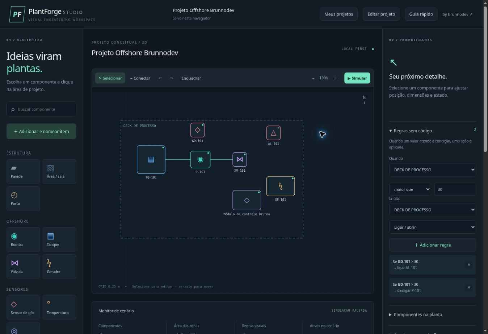

<div align="center">


# PlantForge Studio

### Desenhe o espaço. Nomeie os componentes. Apresente o projeto.

Editor visual de plantas 2D e simulação conceitual para offshore, mercados autônomos e comércios. Sem programar PLC, sem configurar SCADA e sem cadastro.

[Abrir o Studio](https://brunnojob.github.io/plantforge-studio/) · [Primeiros passos](#primeiros-passos) · [PDF e PowerPoint](#pdf-e-powerpoint) · [Arquitetura](#arquitetura) · [Créditos](#créditos)

</div>



## Do desenho à apresentação

Monte uma planta, conecte componentes e experimente regras de automação em uma interface visual. Salve vários trabalhos no navegador e transforme o projeto atual em um relatório PDF ou uma apresentação PowerPoint.

| Desenhar | Personalizar | Experimentar | Apresentar |
| --- | --- | --- | --- |
| Grade, arraste, zoom e conexões | Nomes, dimensões, cores, camadas e observações | Regras visuais e valores manuais de sensores | PDF, PPTX editável, SVG e JSON |

## Recursos disponíveis

- **23 tipos de componente:** paredes, áreas, portas, bombas, tanques, válvulas, geradores, sensores, alarmes, luminárias, acessos, gôndolas, self-checkouts, refrigeradores, câmeras, quadros elétricos, UPS, combate a incêndio, esteiras, itens personalizados e anotações.
- **Adicionar e nomear item:** escolha o tipo, nome, tamanho e cor antes de inserir no centro da área visível.
- **Propriedades:** posição, dimensões, rotação, nome, cor, camada, observação, estado base, valor do sensor e bloqueio de movimentação.
- **Dados do projeto:** nome, autor/responsável, cliente/unidade e observações, também incluídos nos relatórios.
- **Meus projetos:** até 20 trabalhos independentes no mesmo navegador, com cópia e alternância sem substituir o trabalho anterior.
- **Modelos do Supabase:** plataforma offshore, mercado autônomo, sala elétrica e loja/estoque, com cópias locais de reserva caso a consulta falhe.
- **Histórico:** desfazer, refazer, duplicar e excluir componentes, removendo regras e conexões relacionadas.
- **Simulação:** operadores maior, menor ou igual; ações ligar/abrir e desligar/fechar; monitor com regras acionadas e conflitos.
- **Arquivos:** PDF, PPTX, SVG, JSON e impressão. Importar JSON cria um novo projeto local.
- **Acessibilidade:** seleção pela lista de componentes e edição por campos, layout adaptável e respeito à preferência por movimento reduzido.

Camadas organizam os metadados dos itens e aparecem no inventário; ainda não possuem filtros de visibilidade independentes.

## Primeiros passos

1. Abra o [Studio](https://brunnojob.github.io/plantforge-studio/).
2. Clique em **Editar projeto** para definir nome, autor, cliente e observações.
3. Use **Adicionar e nomear item** para criar um componente personalizado. Se preferir inserir vários, escolha um tipo na biblioteca e clique na planta.
4. Selecione um item para renomear e ajustar suas propriedades. Alterações no painel são aplicadas ao concluir a edição do campo.
5. Clique em **Conectar**, depois na origem e no destino.
6. Adicione uma regra com sensor, condição, limite, destino e ação. Clique em **Simular**.
7. Em **Arquivos e exportação**, escolha **Baixar PDF** ou **Baixar PPTX**.

Exemplo offshore: selecione `GD-101`, altere o valor do sensor para `45` e simule. O alarme `AL-101` liga e a bomba `P-101` desliga. Ao reduzir o sensor para `0`, os estados base são restaurados.

Atalhos: `V` ou `Esc` seleciona; `Delete` exclui; `Ctrl+Z` desfaz; `Ctrl+Shift+Z` refaz. No macOS, use Command no lugar de Ctrl. Os atalhos ficam suspensos durante a edição de campos ou com diálogos abertos.

## PDF e PowerPoint

Os downloads são gerados no próprio navegador, com o nome atual do projeto no arquivo:

- **PDF A4 horizontal:** planta como imagem, inventário paginado, regras e observações.
- **PPTX widescreen:** planta com formas e textos editáveis, inventário, regras e observações. Componentes são representados por formas e identificação; conexões são esquemáticas.
- **SVG:** composição vetorial para outros editores.
- **JSON:** documento completo para continuar a edição no PlantForge em outro navegador ou dispositivo.

O relatório usa o estado base ou o resultado do cenário, conforme o modo de simulação no momento da exportação. Bibliotecas de exportação são carregadas sob demanda a partir do próprio Pages, com versões fixadas e licenças em `vendor/`. Não há dependência de CDN para gerar os arquivos.

## GitHub Pages + Supabase, sem login

**O Pages hospeda a aplicação. O Supabase fornece os modelos publicados. Os projetos pessoais ficam apenas no navegador.**

A aplicação consulta a tabela `public.plantforge_templates` usando uma chave publicável e a Data API. A tabela tem RLS e somente `SELECT` para `anon`/`authenticated`, com política que expõe apenas linhas publicadas. Visitantes não podem inserir, alterar ou excluir modelos. Não são enviados projetos, nomes de clientes ou observações ao banco.

A ausência de cadastro é intencional: não há sessão de usuário, login invisível ou sincronização dos projetos pessoais entre dispositivos. Limpar os dados do site apaga os projetos locais. Use JSON como backup e transporte.

O workspace usa `localStorage` em `plantforge.workspace.v2`. Projetos da primeira versão em `plantforge.v1` são migrados automaticamente, mantendo a chave antiga como reserva. Em caso de quota ou bloqueio do armazenamento, o editor informa a falha para que você faça um backup.

Configuração pública em `src/config.js`; esquema e modelos em `supabase/schema.sql` e `supabase/seed.sql`. Nunca coloque chaves `service_role` ou secretas no cliente. Não há analytics da aplicação; GitHub e Supabase aplicam as políticas das próprias infraestruturas.

## Arquitetura

| Módulo | Responsabilidade |
| --- | --- |
| `src/model.js` | Catálogo, propriedades, modelos, validação e histórico |
| `src/simulation.js` | Estados derivados, avaliação de regras e conflitos |
| `src/storage.js` | Workspace local, migração e troca de projetos |
| `src/templates.js` | Consulta validada dos modelos e reserva local |
| `src/exports.js` | Relatórios PDF/PPTX, nomes e enquadramento |
| `src/app.js` | Interações, diálogos, renderização e arquivos |
| `src/style.css` | Tema, responsividade e impressão |

### Semântica da simulação

Sensores têm valores manuais. Cada avaliação começa pelos estados base. Fontes desativadas são ignoradas. Regras conflitantes produzem um evento e **desligar tem prioridade**, independentemente da ordem. Não há cascata, retenção ou temporizadores. Conexões não transmitem automaticamente sinais, energia ou fluidos.

A grade considera 80 unidades por metro. A área exibida é a soma das zonas, incluindo sobreposições. O JSON mantém `version: 1`, com novos metadados opcionais para preservar a compatibilidade. Limites: importação de 2 MB, 500 componentes, 1.000 conexões e 1.000 regras.

## Desenvolvimento

Requisito: Node.js 22 ou superior.

```bash
git clone https://github.com/brunnojob/plantforge-studio.git
cd plantforge-studio
npm ci --ignore-scripts
npm run dev
```

Abra `http://localhost:4173`. É necessário servir por HTTP; abrir o HTML via `file://` não é suportado.

```bash
npm run check
npm test
npm run test:exports
```

Os testes cobrem semântica de simulação, importação, histórico, migração, isolamento dos projetos locais, falha de quota, modelos remotos inválidos, propriedades adicionais, enquadramento e geração/paginação dos arquivos. O último comando gera amostras temporárias em `tmp/export-qa` para inspeção.

Ao atualizar bibliotecas, mantenha versões fixas, execute `npm run vendor` e faça commit de `package-lock.json` e `vendor/`. O override de `image-size` corrige avisos do pacote transitivo usado na execução Node; o bundle para navegador não inclui esse módulo.

## Publicação

Em **Settings → Pages**, mantenha **Deploy from a branch → main → /(root)**. A aplicação usa caminhos relativos e `.nojekyll`. Alterações na `main` são publicadas pelo GitHub Pages. O workflow `Validate` instala as dependências fixadas e executa as verificações e os testes.

## Escopo

PlantForge é uma ferramenta de estudo e prototipagem conceitual. Não substitui CAD profissional, análise de engenharia ou validação de sistemas de segurança. Não importa DWG/DXF, não faz cálculos físicos e não se conecta a equipamentos reais.

Próximas evoluções: filtros de camadas, cotas dedicadas, desenho livre de paredes, seleção múltipla, edição de rotas e cenários temporizados.

## Contribuir

Abra uma issue com o problema, comportamento esperado, passos para reproduzir e um JSON mínimo sem dados privados. Mantenha as regras do domínio independentes da interface e inclua testes ao alterar persistência, importação, simulação ou exportação.

## Créditos

Criado para **brunnodev**, na conta **[brunnojob](https://github.com/brunnojob)**.

**[brunnodev.store](https://brunnodev.store)**

Licença MIT. Exportação com PptxGenJS e jsPDF. AutoCAD e Tinkercad são marcas de seus respectivos titulares; este projeto é independente e não possui afiliação com a Autodesk.
